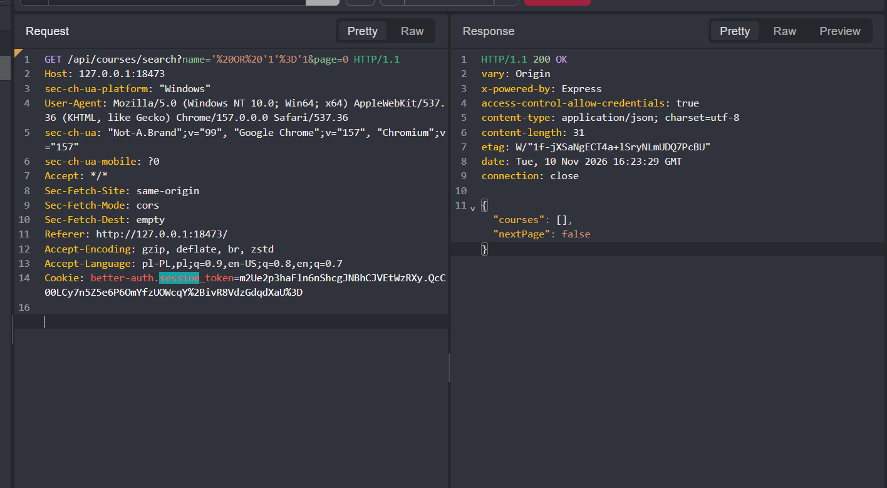

# Bezpieczeństwo w projekcie Zamiennik

> Zastosowanie wiedzy którą pozyskałem z: [PortSwigger Web Security Academy](https://portswigger.net/web-security) w celu tworzenia bezpiecznych aplikacji webowych.

**Autor:** Jan Wojtysiak

**Narzędzia:**
- Burp Suite Community Edition, Caido (Proxy, Repeater, Intruder)
- DevTools przeglądarki (Network, Application → Cookies)
- `curl`

**Legenda statusów:**
- ✅ **Bezpieczne** — atak się nie udał
- ❌ **Podatne** — atak się udał (opis poprawki w danym dziale)
- 🔧 **Naprawione** — było podatne, po poprawce test przechodzi
- ⏳ **Do wykonania**

**Spis treści:**
1. [Uwierzytelnianie i enumeracja kont](#1-uwierzytelnianie-i-enumeracja-kont)
2. [SQL Injection](#2-sql-injection)
3. [Cross-Site Scripting (XSS)](#3-cross-site-scripting-xss)
4. [Cross-Site Request Forgery (CSRF)](#4-cross-site-request-forgery-csrf)
5. [Ujawnianie informacji i konfiguracja](#5-ujawnianie-informacji-i-konfiguracja)

---

## 1. Uwierzytelnianie i enumeracja kont

### Mechanizmy obronne

#### 1.1 Rejestracja tylko z domeną PWr
**Plik:** `backend/src/lib/auth.ts`

Hook `before` w Better Auth sprawdza adres przy `/sign-up/email` schematem Zod. Dozwolona jest tylko domena `pwr.edu.pl` i jej subdomeny (np. `student.pwr.edu.pl`). Inny adres kończy się błędem `400` „Dozwolone są tylko adresy @pwr.edu.pl”. Walidacja jest po stronie serwera, więc nie da się jej obejść, wysyłając żądanie z pominięciem frontendu.

#### 1.2 Ochrona przed enumeracją kont przy rejestracji
**Pliki:** `backend/src/lib/auth.ts`, `frontend/src/components/AuthPage.tsx`

**Problem:** rejestracja na zajęty adres zwracała `422` z kodem `USER_ALREADY_EXISTS_USE_ANOTHER_EMAIL`, a frontend wyświetlał „Konto z tym adresem email już istnieje”. Atakujący mógł więc sprawdzić, czy dany student ma konto w serwisie.

**Poprawka:**
- Backend: w Better Auth ustawiłem `emailAndPassword.autoSignIn: false`. Rejestracja na istniejący e-mail zwraca teraz **identyczną** odpowiedź jak dla nowego konta (`200`, `{ token: null, user: {…} }` z fałszywym `id`). Better Auth dodatkowo hashuje hasło także w tej ścieżce, więc czas odpowiedzi jest podobny (ochrona przed enumeracją przez timing).
- Frontend: usunąłem komunikaty `USER_ALREADY_EXISTS` i `USER_ALREADY_EXISTS_USE_ANOTHER_EMAIL`. Po każdej rejestracji wyświetla się ten sam komunikat: „Jeśli adres jest poprawny, konto zostało utworzone. Zaloguj się.”

**Ograniczenie:** bez weryfikacji e-mail atakujący nadal może po „rejestracji” spróbować się zalogować i wywnioskować coś z porażki. Pełne rozwiązanie to `requireEmailVerification: true` z linkiem aktywacyjnym.

---

## 2. SQL Injection

### Mechanizmy obronne
- Wszystkie zapytania do bazy idą przez Prisma, które parametryzuje wartości.
- Wyszukiwanie przedmiotów nie odpytuje naszej bazy, tylko USOS API (parametry przekazywane przez `URLSearchParams`).

### Testy

#### T-01: ✅ SQL injection w wyszukiwarce przedmiotów
**Data:** 2026-11-10 | **Status:** ✅ Bezpieczne
**Cel:** sprawdzić, czy parametr `name` w `GET /api/courses/search` pozwala wstrzyknąć SQL i zwrócić wszystkie rekordy.

**Żądanie** (Repeater, zalogowany użytkownik):
```http
GET /api/courses/search?name='%20OR%20'1'%3D'1&page=0 HTTP/1.1
Host: 127.0.0.1:18473
Cookie: better-auth.session_token=…
```

**Odpowiedź:**
```http
HTTP/1.1 200 OK
content-type: application/json; charset=utf-8

{"courses":[],"nextPage":false}
```



**Wynik:** pusta lista, bez błędu SQL i bez zwrócenia wszystkich przedmiotów. Wartość `name` nie trafia do naszej bazy. Backend przekazuje ją przez `URLSearchParams` do USOS API (`courses/search`), które traktuje ją jako zwykły tekst wyszukiwania. Pozostałe zapytania do bazy idą przez Prisma, które parametryzuje wartości.

---

## 3. Cross-Site Scripting (XSS)

### Mechanizmy obronne
- Dane renderowane są przez React, który domyślnie escapuje wartości w JSX.
- W kodzie frontendu nie występuje `dangerouslySetInnerHTML`, `innerHTML`, `eval` ani `document.write`.
- Ciasteczko sesji ma flagę `HttpOnly` (domyślnie w Better Auth), więc nawet udany XSS nie odczyta go przez `document.cookie`.

### Testy

#### T-02: ✅ DOM-based XSS (DOM Invader)
**Data:** 2026-11-16 | **Status:** ✅ Bezpieczne
**Cel:** sprawdzić, czy dane wpisywane przez użytkownika trafiają do niebezpiecznych sinków DOM (np. `innerHTML`, `eval`, `document.write`), co mogłoby umożliwić atak DOM XSS.

**Narzędzie:** Burp Suite → wbudowana przeglądarka z rozszerzeniem DOM Invader (v2.0.12)

**Metoda:**
1. Włączono DOM Invader z canary `esiax0z3`.
2. Zalogowano się do aplikacji i przejrzano dostępne podstrony (formularz logowania, wyszukiwarka, widoki CV).
3. W zakładce DOM Invader (DevTools → DOM) sprawdzono wyniki automatycznego skanowania.

**Wynik skanowania:**
```
Sinks (0)
Sources (0)
```


**Wynik:** DOM Invader nie znalazł żadnych sinków ani źródeł. Aplikacja nie wstawia danych użytkownika do DOM przez niebezpieczne metody (`innerHTML`, `eval`, `document.write`). Dane renderowane są przez React, który domyślnie escapuje wartości w JSX — użycie `dangerouslySetInnerHTML` nie występuje w kodzie frontendu.

---

## 4. Cross-Site Request Forgery (CSRF) 

Kolejne mechanizmy obronne dodane do aplikacji, tym razem przed CSRF (dodane 17.11.2026 po zrealizowaniu labów). Po pierwsze na stronie nie mieliśmy JAKIEJKOLWIEK obrony przed CSRF. Nie mieliśmy tokenu CSRF na swojej stronie. Dowiedziałem się, że można go umieścic w formularzu jak i nagłówkach. Oba podejścia są znacznie bezpieczniejesze niż poleganie na samych ciasteczkach, ale ten w nagłówku jest duzo bardziej profesjonalny i uzywany w profesjonalnych rozwiazaniach, poniewaz nie da sie go podrobic, przekierowujac cel na fałszywa domene z formularzem ktory automatycznie wysyla zapytanie na nasza strone, gdzie jestesmy juz zalgoowani.

Obrona jest wielowarstwowa: pierwsza warstwa działa w przeglądarce (ciasteczko nie zostaje wysłane), kolejne na serwerze (żądanie spoza naszej domeny albo bez nagłówka `X-CSRF-Protection` zostaje odrzucone).


### Mechanizmy obronne

#### 4.1 Ciasteczka `SameSite=Strict`
**Plik:** `backend/src/lib/auth.ts`

```ts
advanced: {
  defaultCookieAttributes: { sameSite: "strict" },
},
```

Better Auth domyślnie ustawia `SameSite=Lax`. Zmieniłem to na `Strict` dla wszystkich ciasteczek sesji (`better-auth.session_token` i pozostałych). Przeglądarka nie dołącza wtedy ciasteczka do żadnego żądania zainicjowanego z innej witryny — ani do `POST` z formularza, ani do nawigacji top-level (`GET` po kliknięciu linku).

Dlaczego `Strict`, a nie domyślne `Lax`:
- `Lax` wysyła ciasteczko przy nawigacji top-level metodą `GET`. Jeśli jakikolwiek endpoint zmienia stan przez `GET` albo serwer akceptuje nadpisanie metody (np. `_method=POST`), atak przechodzi.
- Chrome przez pierwsze 2 minuty po ustawieniu ciasteczka bez jawnego `SameSite` wysyła je także przy cross-site `POST` z nawigacji top-level (wyjątek „Lax+POST” dla SSO), co daje okno na atak. Jawne `Strict` tego wyjątku nie ma.

**Koszt:** po wejściu z zewnętrznego linku (np. z maila) pierwsze żądanie nie niesie ciasteczka. W naszej aplikacji to nie przeszkadza: frontend to SPA, a zapytania do API wysyła `fetch` z tej samej witryny, więc ciasteczko jest już dołączane.

**Ograniczenie:** `SameSite` chroni przed innymi witrynami (site = schemat + domena rejestrowalna), a nie przed innymi **originami**. Podatna strona na tej samej domenie (np. XSS na innej subdomenie) mogłaby wysłać żądanie z ciasteczkiem. Dlatego potrzebna jest druga warstwa po stronie serwera.

#### 4.2 Sprawdzanie nagłówka `Referer`
**Pliki:** `backend/src/lib/csrfDefenses.ts`, `backend/src/app.ts`

Middleware `requireSameOriginReferer` działa na wszystkich ścieżkach `/api` (także `/api/auth`) i dla **każdej metody HTTP**, również `GET` i `HEAD` (gdy tego nie ma, to jest czesty blad ze mozemy podmienic metode z POST na GET i wykonac żadanie.). Wymaga, aby nagłówek `Referer` pochodził z naszego frontendu (`FRONTEND_URL` oraz jego wariant `127.0.0.1`). W przeciwnym razie zwraca `403 Forbidden`.

Dlaczego bez wyjątku dla „bezpiecznych” metod: reguła jest jedna i prosta, więc nie da się jej obejść endpointem, który przez pomyłkę zmienia stan przez `GET`, ani nadpisaniem metody (`_method=POST`). Jedynie preflight `OPTIONS` obsługuje wcześniej middleware CORS, a `/health` leży poza `/api`.

Implementacja omija dwie typowe pułapki z labów PortSwigger:
- **Brak nagłówka też jest odrzucany.** Gdyby sprawdzanie działało tylko, gdy `Referer` jest obecny, atakujący wyłączyłby go na swojej stronie przez `<meta name="referrer" content="no-referrer">`.
- **Porównywany jest dokładny origin, a nie fragment tekstu.** `Referer` jest parsowany przez `new URL()` i jego `origin` musi być identyczny z dozwolonym. Sprawdzenie typu „czy zawiera `localhost:18473`” przepuściłoby `http://localhost:18473.evil.example/` albo `https://evil.example/?http://localhost:18473`.

Dodatkowo Better Auth sam weryfikuje nagłówek `Origin` dla swoich endpointów względem `trustedOrigins`.

#### 4.3 Niestandardowy nagłówek `X-CSRF-Protection` zamiast pola formularza

To co opisane wyzej.


Ograniczenie: ochrona opiera się na poprawnej konfiguracji CORS. Gdyby CORS dopuszczał dowolny origin z `credentials: true`, obca strona mogłaby wysłać nagłówek. Nie chroni też przed XSS na naszej stronie, bo skrypt atakującego działałby wtedy z naszego originu.

### Testy

#### T-03: ⏳ CSRF — formularz z obcej domeny
**Status:** ⏳ Do wykonania
**Cel:** sprawdzić, czy strona atakującego może w imieniu zalogowanego użytkownika dodać ofertę.
---

## 5. Ujawnianie informacji i konfiguracja

### Mechanizmy obronne

#### 5.1 Ogólne komunikaty błędów
Kontrolery łapią wyjątki i zwracają ogólny komunikat `500` bez stack trace’a ani szczegółów bazy.

#### 5.2 Porty dostępne tylko lokalnie
**Plik:** `compose.yaml`

Porty backendu i frontendu są bindowane do `127.0.0.1`, a PostgreSQL nie jest wystawiony na hosta.
