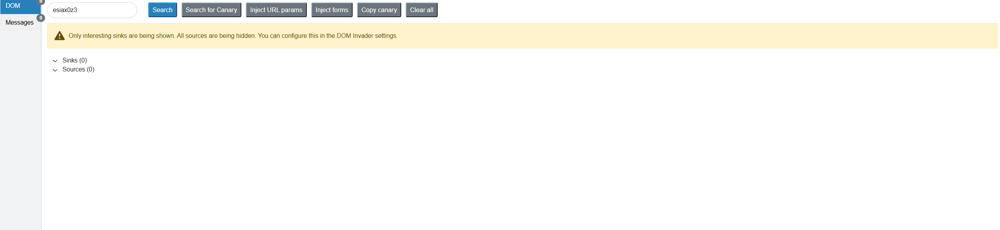

# Bezpieczeństwo w projekcie Zamiennik

> Zastosowanie wiedzy którą pozyskałem z: [PortSwigger Web Security Academy](https://portswigger.net/web-security) w celu tworzenia bezpiecznych aplikacji webowych..

**Autor:** Jan Wojtysiak

**Narzędzia:**
- Burp Suite Community Edition, Caido (Proxy, Repeater, Intruder)
- DevTools przeglądarki (Network, Application → Cookies)
- `curl`


**Legenda statusów:**
- ✅ **Bezpieczne** — atak się nie udał
- ❌ **Podatne** — atak się udał (opis poprawki w sekcji 5)
- 🔧 **Naprawione** — było podatne, po poprawce test przechodzi
- ⏳ **Do wykonania**

---

## 3. Zabezpieczenia wprowadzone w projekcie

### 3.1 Rejestracja tylko z domeną PWr


### 3.2 Ogólne komunikaty błędów
Kontrolery łapią wyjątki i zwracają ogólny komunikat `500` bez stack trace’a ani szczegółów bazy.

### 3.3 Ochrona przed enumeracją kont przy rejestracji
**Pliki:** `backend/src/lib/auth.ts`, `frontend/src/components/AuthPage.tsx`

**Problem:** rejestracja na zajęty adres zwracała `422` z kodem `USER_ALREADY_EXISTS_USE_ANOTHER_EMAIL`, a frontend wyświetlał „Konto z tym adresem email już istnieje”. Atakujący mógł więc sprawdzić, czy dany student ma konto w serwisie.

**Poprawka:**
- Backend: w Better Auth ustawiłem `emailAndPassword.autoSignIn: false`. Rejestracja na istniejący e-mail zwraca teraz **identyczną** odpowiedź jak dla nowego konta (`200`, `{ token: null, user: {…} }` z fałszywym `id`). Better Auth dodatkowo hashuje hasło także w tej ścieżce, więc czas odpowiedzi jest podobny (ochrona przed enumeracją przez timing).
- Frontend: usunąłem komunikaty `USER_ALREADY_EXISTS` i `USER_ALREADY_EXISTS_USE_ANOTHER_EMAIL`. Po każdej rejestracji wyświetla się ten sam komunikat: „Jeśli adres jest poprawny, konto zostało utworzone. Zaloguj się.”

**Ograniczenie:** bez weryfikacji e-mail (T-02) atakujący nadal może po „rejestracji” spróbować się zalogować i wywnioskować coś z porażki. Pełne rozwiązanie to `requireEmailVerification: true` z linkiem aktywacyjnym.


### 3.4 Porty dostępne tylko lokalnie
**Plik:** `compose.yaml`
Porty backendu i frontendu są bindowane do `127.0.0.1`, a PostgreSQL nie jest wystawiony na hosta.

---

## 4. Testy manualne

### T-01: ✅ SQL injection w wyszukiwarce przedmiotów
**Data:** 2026-11-10 | **Status:** ✅ Bezpieczne
**Cel:** sprawdzić, czy parametr `name` w `GET /api/courses/search` pozwala wstrzyknąć SQL i zwrócić wszystkie rekordy.

**Żądanie** (Repeater, zalogowany użytkownik):
```http
GET /api/courses/search?name='%20OR%20'1'%3D'1&page=0 HTTP/1.1
Host: 127.0.0.1:18473
Cookie: better-auth.session_token=…
```

**Odpowiedź:**
```http
HTTP/1.1 200 OK
content-type: application/json; charset=utf-8

{"courses":[],"nextPage":false}
```


**Wynik:** pusta lista, bez błędu SQL i bez zwrócenia wszystkich przedmiotów. Wartość `name` nie trafia do naszej bazy. Backend przekazuje ją przez `URLSearchParams` do USOS API (`courses/search`), które traktuje ją jako zwykły tekst wyszukiwania. Pozostałe zapytania do bazy idą przez Prisma, które parametryzuje wartości.

### T-02: ✅ DOM-based XSS (DOM Invader)
**Data:** 2026-11-16 | **Status:** ✅ Bezpieczne
**Cel:** sprawdzić, czy dane wpisywane przez użytkownika trafiają do niebezpiecznych sinków DOM (np. `innerHTML`, `eval`, `document.write`), co mogłoby umożliwić atak DOM XSS.

**Narzędzie:** Burp Suite → wbudowana przeglądarka z rozszerzeniem DOM Invader (v2.0.12)

**Metoda:**
1. Włączono DOM Invader z canary `esiax0z3`.
2. Zalogowano się do aplikacji i przejrzano dostępne podstrony (formularz logowania, wyszukiwarka, widoki CV).
3. W zakładce DOM Invader (DevTools → DOM) sprawdzono wyniki automatycznego skanowania.

**Wynik:**
```
Sinks (0)
Sources (0)
```



**Wynik:** DOM Invader nie znalazł żadnych sinków ani źródeł. Aplikacja nie wstawia danych użytkownika do DOM przez niebezpieczne metody (`innerHTML`, `eval`, `document.write`). Dane renderowane są przez React, który domyślnie escapuje wartości w JSX — użycie `dangerouslySetInnerHTML` nie występuje w kodzie frontendu.